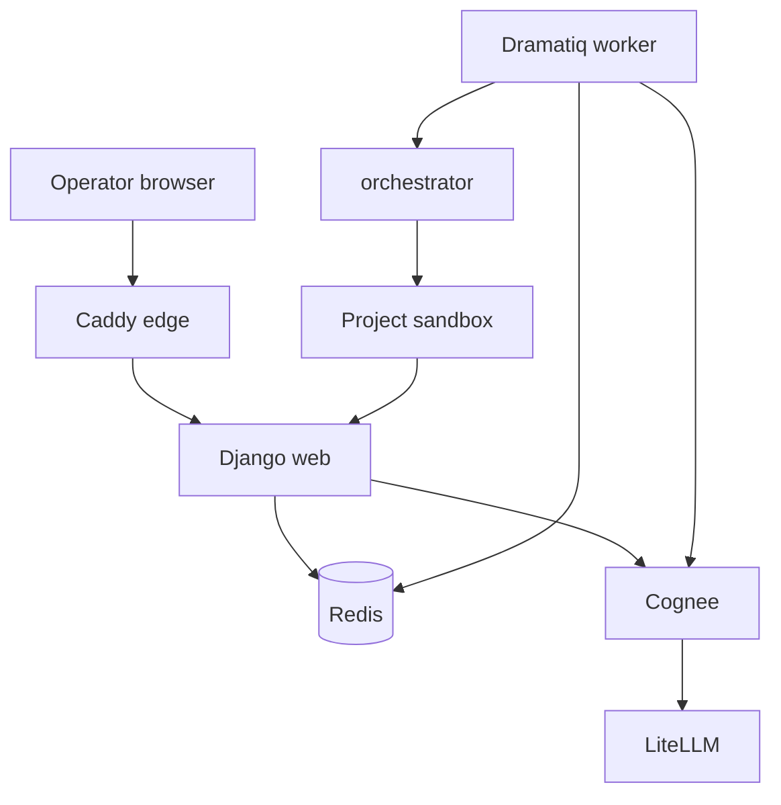
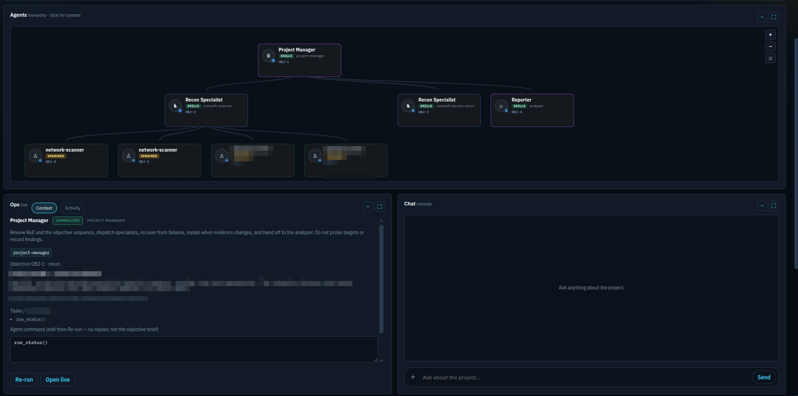
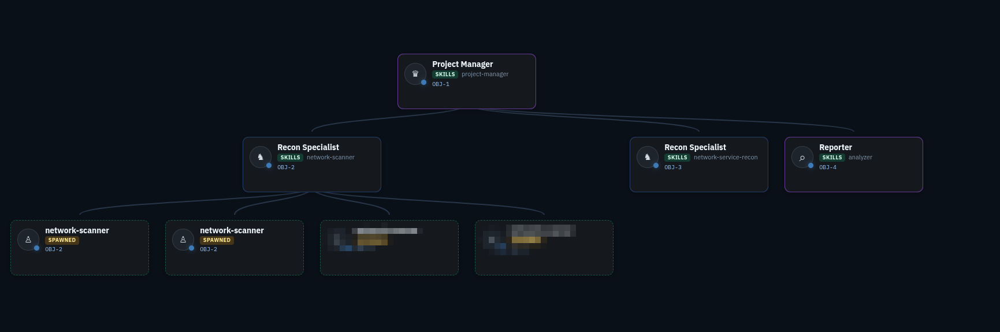
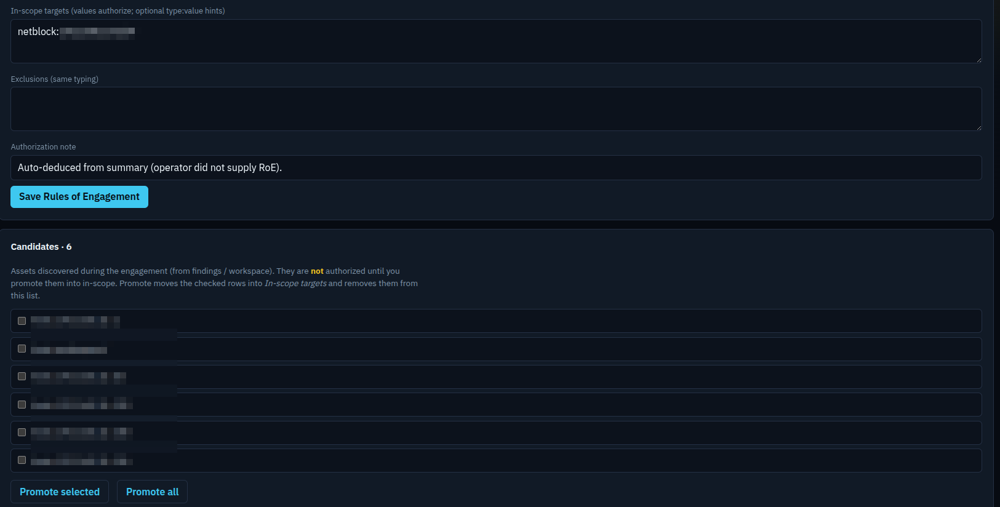
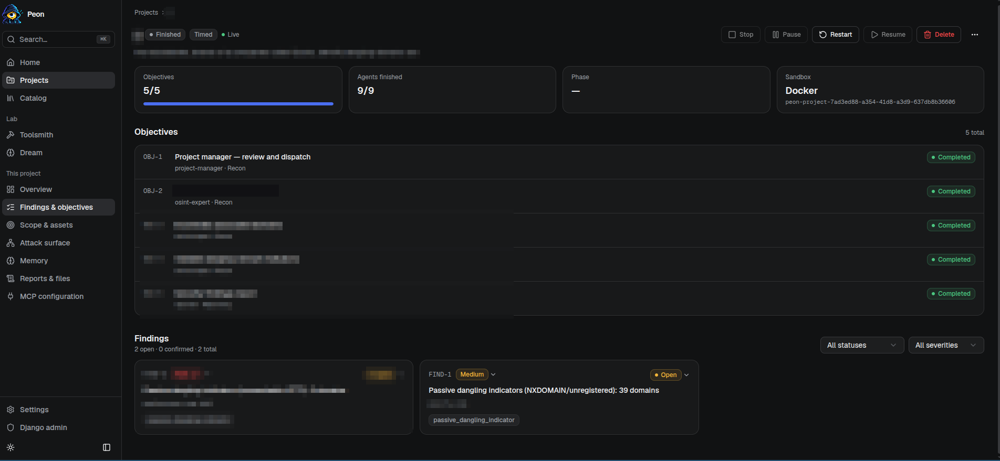
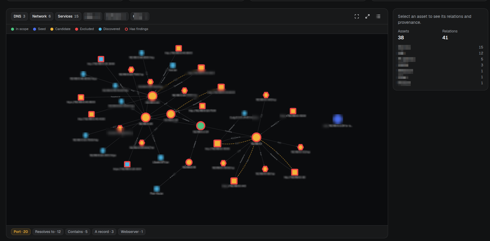
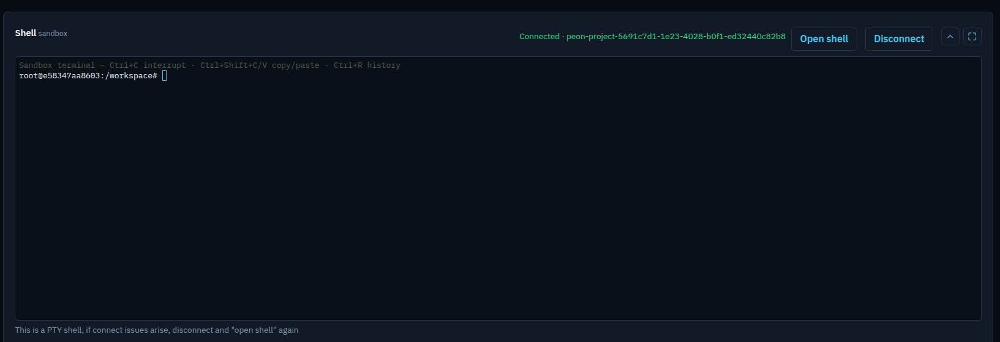
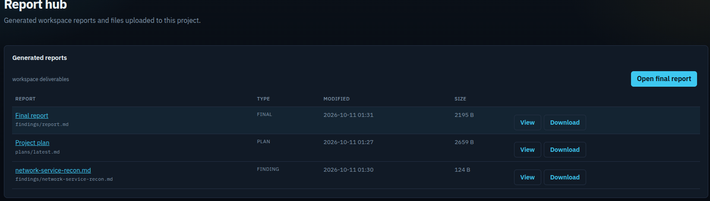

<p align="center">
  
</p>

<p align="center">
  <strong>AI agents runtime</strong> for cybersecurity tasks.<br>
  Prompt → plan → objectives → sandboxed agents.
</p>

> **Disclaimer:** WIP — bugs are expected.

---

## Overview

Peon turns an operator brief into a plan, objectives, and a **crew** of sandboxed agents: a **project manager**, catalog **roles**, and Dramatiq **worker** jobs that run tools and scripts. Skills and CLI tools extend as catalog files, not forked app code. Live jobs can coordinate via **A2A** messages; specialists can spawn more workers when work fans out.

Operators set Rules of Engagement, steer live jobs, promote discoveries into scope, triage findings, and take reports. Between engagements, Peon keeps a **semantic memory** (fed live, consolidated on a dream cycle, recalled into new projects) so crews do not start every engagement from zero — that is what **Cognee** is for.

---

## Stack

| Layer | Technology |
|---|---|
| Control plane & UI | **Django** (`peon/`) |
| Agents / planning / skills | **orchestrator/** — CrewAI |
| LLM | **LiteLLM** in-process (default **OpenRouter**); `/v1` proxy for OpenCode + Cognee |
| Memory | **[Cognee](https://www.cognee.ai/)**|
| Job queue | **Dramatiq** + **Redis** |
| Edge | **Caddy** TLS → Django |
| Execution | Per-project **Docker** sandbox docker|
| Catalogs | `skills/` · `tools/catalog/` · `helpers/` |
| Live feed / host helpers | Unix **stream** + **RPC** sockets |

Compose services: `edge` · `web` · `redis` · `worker` · `cognee`. Build the job image with `--profile build`; enable LiteLLM via Peon Settings or `--profile llm-proxy`.



---

## Features

### Crew

- **PM** — `project-manager` plans objectives, steers/cancels, coordinates specialists.
- **Roles** — platform DB identities (Lab → Roles) + skill affinity sidecars (`peon.affinity.yaml`); spawn armory is indexed, not hand-listed.
- **Workers** — One Dramatiq **Job** per objective/child in the sandbox; `spawn_work` / `wait_for_work` for fan-out.
- **A2A** — Structured `AgentMessage` between live jobs (not chat scraping). Spawn creates jobs; A2A coordinates them.

### Engagement

- **Plan / replan** — Brief or chat → objectives → jobs; rewritable mid-run or after finish.
- **Rules of Engagement** — Scope is authorization; promote candidates before active probes.
- **HITL** — Chat, sandbox PTY, and prompts when an agent needs operator input.
- **Steer** — Instruct live agents or edit/re-run a job command.
- **Findings & attack surface** — Severity-tagged discoveries + asset graph.
- **Reports** — Analyzer synthesizes workspace evidence.
- **Watchdog** — Scheduled ticks for long-running roles.

### Sandbox & tooling

- **Per-project sandbox** — Isolated Docker; artifacts stay in-project; wiped on delete.
- **Catalogs** — `skills/<id>/SKILL.md`, `tools/catalog/*.yaml`.
- **Install cascade** — PATH → catalog YAML → LLM recipe (`apt` / `github_release` / `git_clone` / `pip` / `custom` + `verify`).
- **Host RPC** — Sandbox helpers → host over Unix RPC (separate from live stream).
- **MCP (optional)** — Operator MCP servers inside the sandbox.

### Lab

- **Toolsmith** — Prompt Poen to prepare installation package for a complex/custom tool or skill. if code writting is needed, Peon uses OpenCode; Toolsmish also help linting and testing draft packages in a Lab sandbox (not mid-engagement). 
- **Dream** — Improve performance by curating and improving persistant memory by improvement cycle. improved memory is recalled when a new project starts, reducing potential issues nad learning from previous prompts/mistakes.

### Memory (Cognee)

crews error fiexes, replans and issues will be forgeten over time; Cognee keeps *how* work went (project transcripts).

- **Feed** — Labeled transcript JSON → `peon` + `project_<id>` datasets.
- **Dream** — an attempt to follow Anthropic Dreaming concept, Cyclic `dream_scheduler` (`PEON_DREAMING_INTERVAL_S`) runs `improve()` offline; Lab can trigger manually.
- **Recall** — New projects get workspace `memory_bootstrap.md` for agents (never written into the project description).

Settings: `COGNEE_ENABLED`, `COGNEE_PORT`, `LITELLM_MODEL` (chat via OpenRouter), `PEON_MEMORY_ENABLED`, `PEON_DREAMING_INTERVAL_S`. Peon talks to the Cognee **sidecar REST API** (not `import cognee` in-process).

---

## Screenshots

### Dashboard



### Agents graph


### Rules of Engagement



### Findings



### Attack surface



### In-browser terminal



### Report hub



---

## How to run

### Prerequisites

- Docker and Docker Compose
- An LLM API key (OpenRouter by default; see `.env.example`)

### Start

```bash
cp .env.example .env
# Set OPENROUTER_API_KEY (or the key for your LLM_PROVIDER)

docker compose up -d --build

# Kali-based job sandbox image
docker compose --profile build build sandbox

# LiteLLM /v1 — required for Cognee + Toolsmith OpenCode
# Prefer enabling LLM_PROXY_ENABLED in Peon Settings, or:
docker compose --profile llm-proxy up -d

curl -k -fsS https://127.0.0.1:${WEB_PORT:-8000}/health/
```

UI: **https://127.0.0.1:8000/** (self-signed cert via edge).

| Variable | Default | Host service |
|---|---|---|
| `WEB_PORT` | `8000` | HTTPS edge → Django |
| `COGNEE_PORT` | `8001` | Cognee (listen + publish) |
| `LLM_PROXY_PORT` | `4000` | LiteLLM |

Keep host ports distinct. On the Compose network Peon uses `http://cognee:<COGNEE_PORT>`.

### First session

1. Create a **Project** (title, brief, optional in-scope targets / uploads).
2. Plan and start agents from the war room.
3. Promote **candidates** into Rules of Engagement when accepted.
4. Triage **findings**; use **attack surface** and **report hub** as work lands.
5. Use **Lab → Dream** to check memory, recall, or improve once data has been fed.

### Useful commands

```bash
docker compose logs -f worker
docker compose logs -f cognee
docker compose down
```

Port busy? Adjust `WEB_PORT`, `PUBLIC_URL`, `CSRF_TRUSTED_ORIGINS`, and if needed `COGNEE_PORT` in `.env`.

---

## Layout

| Path | Role |
|---|---|
| `peon/` | Django control plane + UI |
| `orchestrator/` | Planning, agent runtime, Cognee client |
| `skills/` · `helpers/` · `tools/` | Skills, helpers, CLI catalog |
| `Docker/` · `docker-compose.yml` | Images and Compose stack |
| `docs/` | Design notes (memory, control plane, …) |
| `workspaces/<project-id>/` | Project artifacts (sandbox mount) |
| `workspaces/platform/` | Platform SQLite / non-project data (never in sandboxes) |
